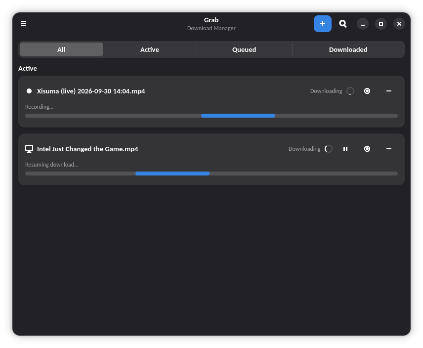
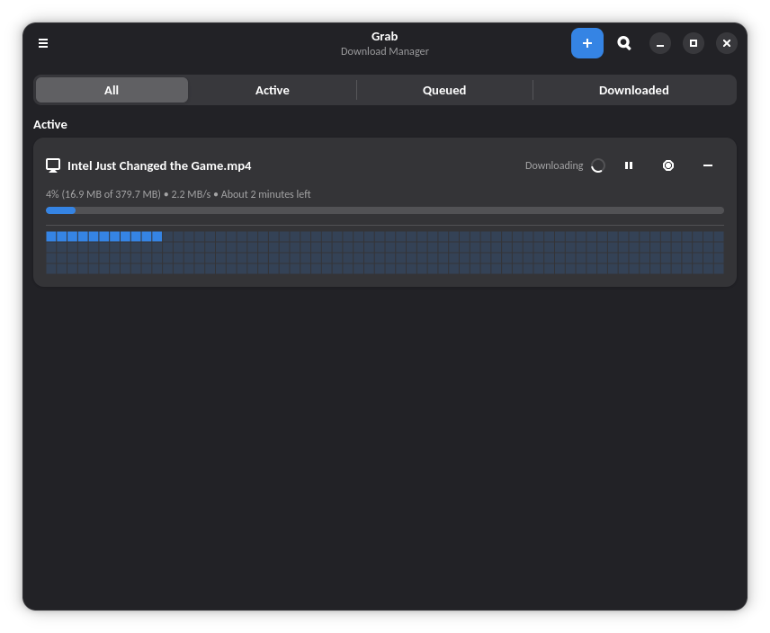
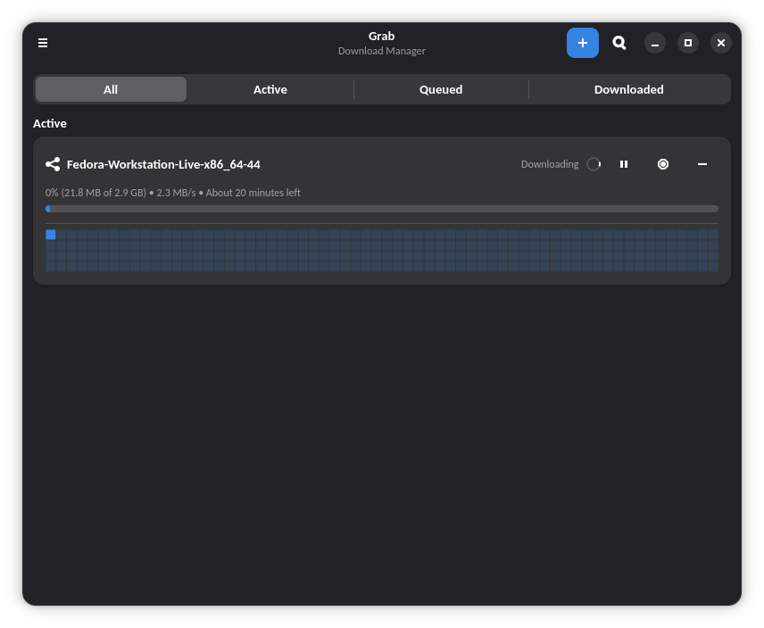
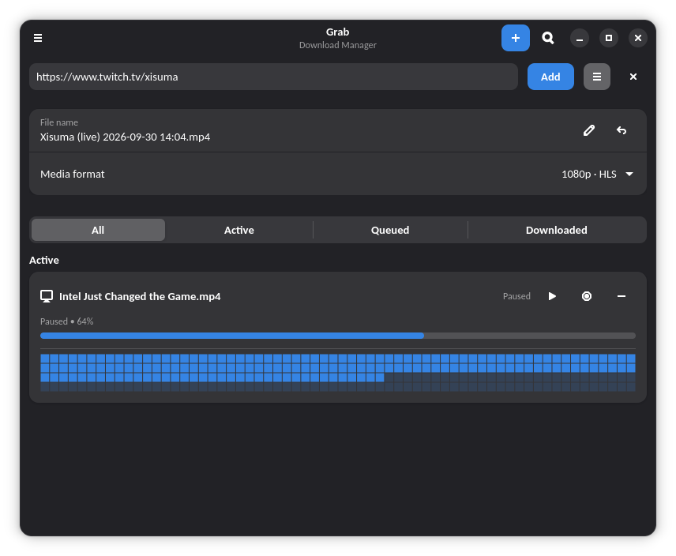

# Grab

**A download manager for GNOME.**

Download files, videos, music, image galleries, torrents, and live streams from one focused app.

## What you can do

- **Download faster** — download large files efficiently and resume interrupted downloads.
- **Save videos and music** — choose the quality and format available from supported websites.
- **Download galleries** — save images and collections from supported sites.
- **Manage torrents** — add magnet links or torrent files, choose the files you need, and control seeding.
- **Record live streams** — capture streams while they are still broadcasting.
- **Send downloads from your browser** — use the companion extension with Firefox and Chromium-based browsers.
- **Stay in your flow** — a clean, keyboard-friendly interface made for the GNOME desktop.

## Screenshots

| Downloads | Torrents |
|---|---|
|  |  |

## Get Grab

[Browse the latest releases](https://github.com/Linuxuser67/Grab/releases)

Send browser downloads straight to Grab with the [Grab browser extension](https://github.com/Linuxuser67/Grab-browser-extension).
